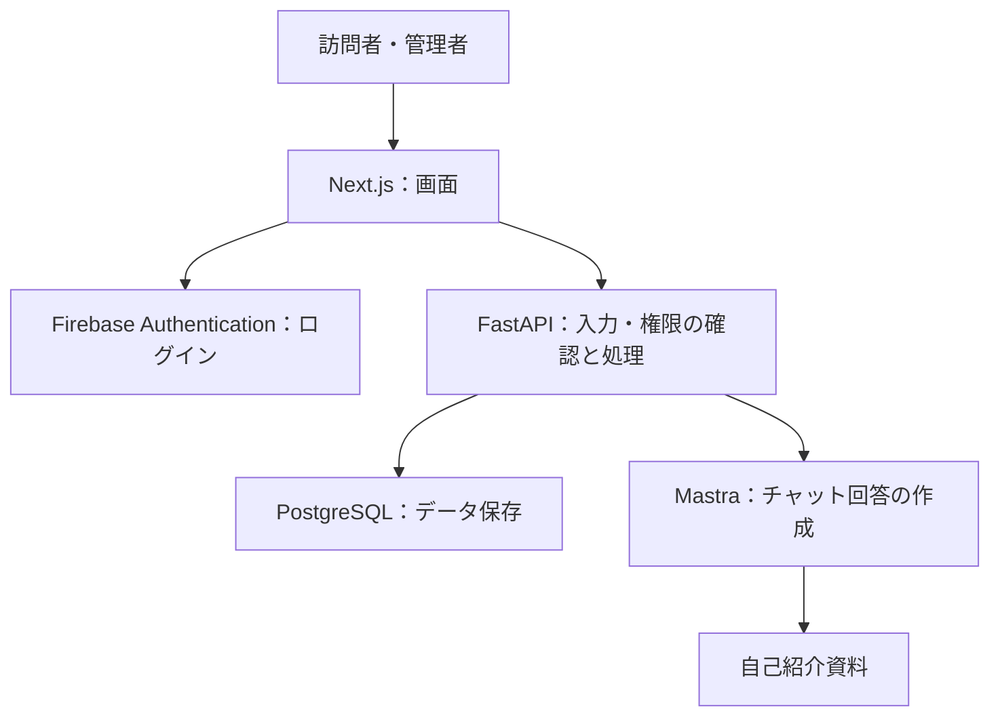

# 課題について
## 開発環境について

Next.js, FastAPI, Mastra, PostgreSQL の構成で開発を進めてください。
必要な機能要件

## ポートフォリオを作成してください。
- トップページ
- プロフィール（画像付き）
- 実績
- スキル
- コンタクト
    - 問い合わせフォーム
- チャットボット
    - 自己紹介用のPDFなどを参照させて、サイトの訪問者があなたについて質問できるチャット機能を開発してください。
- 管理画面
    - トップページのコンテンツを管理できるようなページ
    - 管理者としてログインしたユーザのみアクセス可能
- Firebaseを使って認証・認可機能を入れてください。: Firebase は個人のアカウントを利用してください。

- 認証されていないユーザが管理画面のURLへアクセスした際、HTTPステータスコード404で応答するようにしてください。（参考：Github/Notion）
- 画像データも登録・更新ができるようにしてください。
    - 画像データは DB で保持してください。（AWSを使用する場合S3でも可）
- Firebaseのconfigは環境変数で管理するようにしてください。

# 設計メモ
|機能No. | 誰が        | できること              |
| --| --------- | ------------------ |
|1 | 訪問者       | プロフィール・実績・スキルを見る   |
|2 | 訪問者       | 問い合わせを送る           |
|3 | 訪問者       | チャットであなたについて質問する   |
|4 | 管理者       | ログイン・ログアウトする       |
|5 | 管理者       | プロフィール・実績・スキルを変更する |
|6 | 管理者       | 画像を登録・変更する         |
|7 | 管理者       | 問い合わせ一覧・本文を読む         |
|8 | 未ログインの訪問者 | 管理画面へアクセスすると404が返る |

## 1.プロフィール・実績・スキル
名前・プロフィール画像・スキル・自己紹介文
## 2.問い合わせ

訪問者は、名前・メールアドレス・本文を入力して送信できる。
問い合わせはDBに保存する。
管理者だけが、管理画面で問い合わせ一覧と本文を読める。
返信は普段のメールから行う。サイト内の返信機能は作らない。

## 3.チャットボット
## 4.管理：管理画面ログインログアウト
## 5.管理：プロフィール・実績・スキル編集
## 6.管理：画像登録・変更
## 7.管理：問い合わせ一覧・本文を読む
## 8.未ログインの訪問者：管理画面へアクセスすると404

# システム構成

画面はNext.jsで作成し、DBの取得・更新はFastAPIを通して行う。
FastAPIで入力内容や操作権限を確認する。
チャットの質問もFastAPIを経由してMastraへ送る。

矢印は依頼の方向を示す。結果は逆方向に返る。
認証の詳しい流れは別途整理する。

# DB/テーブル
## profile
| 項目名    | 保存するもの       | 例        |
| ------ | ------------ | -------- |
| `id`   | id | `1`      |
| `name` | 名前         | `岡本麻理絵` |
| `bio` | 自己紹介文         | `自己紹介文` |
| `image_id` | 画像id         | `1` |

## skills
| 項目名    | 保存するもの       | 例        |
| ------ | ------------ | -------- |
| `id`   | スキル1件を識別する番号 | `1`      |
| `name` | スキル名         | `Python` |

## image
| 項目名    | 保存するもの       | 例        |
| ------ | ------------ | -------- |
| `id`   | 画像1件を識別する番号 | `1`      |
| `content_type` | 画像の保存形式         | `JPEG` |
| `data` | 画像本体         |  |

# 表示用API
| API                | 返すもの          |
| ------------------ | ------------- |
| `GET /profile`     | 名前・自己紹介文・画像ID |
| `GET /skills`      | スキルの一覧        |
| `GET /images/{id}` | 指定した画像本体      |
